# Screenshots

## In the game

Chat:

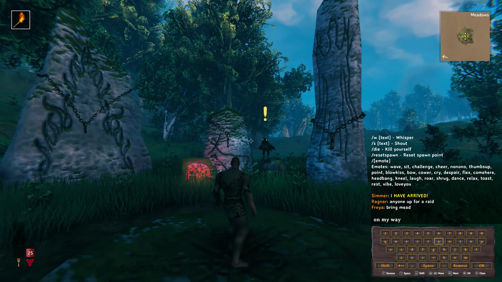

Build menu search:

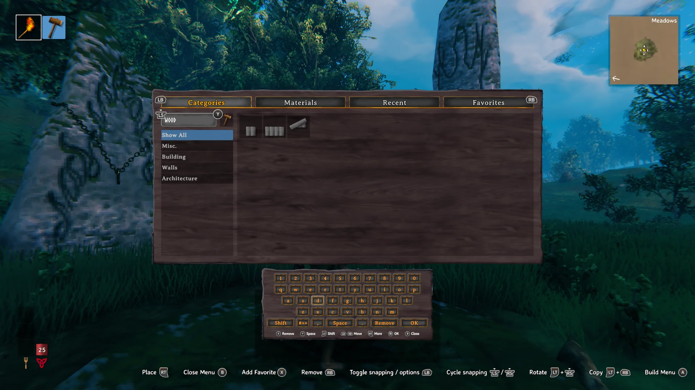

Portal tag:

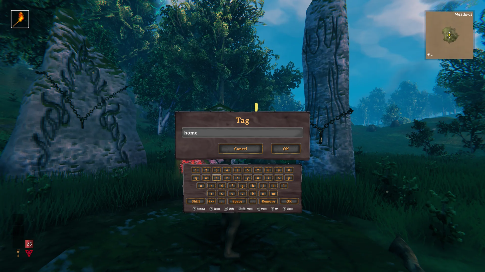

Map pin name:

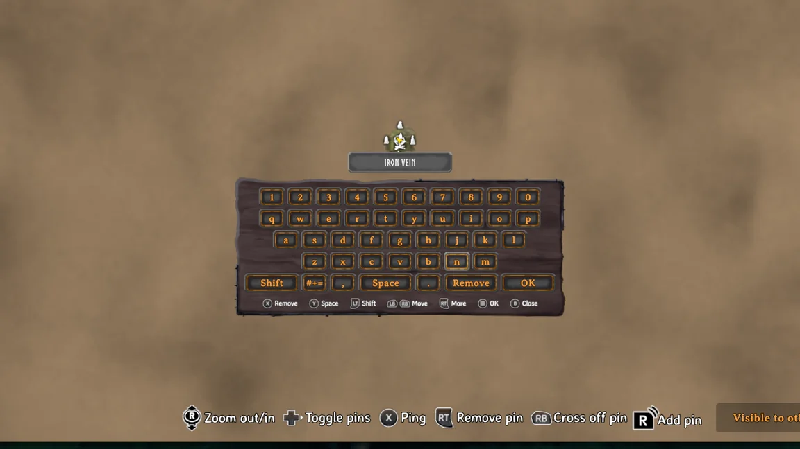

New world:

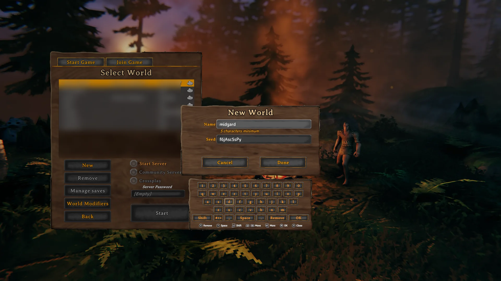

Server password, with the keyboard next to the menu:

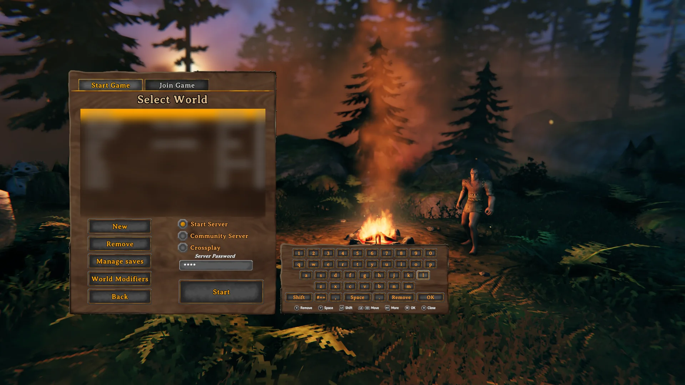

## Languages

French, RT on `e` shows the accented variants on the top row:

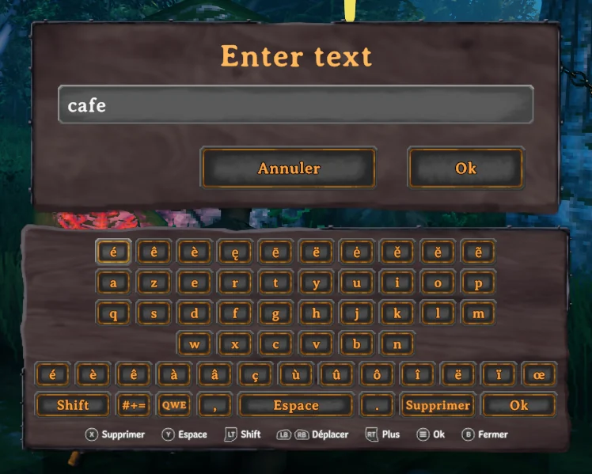

Japanese, kanji suggestions for a kana reading:

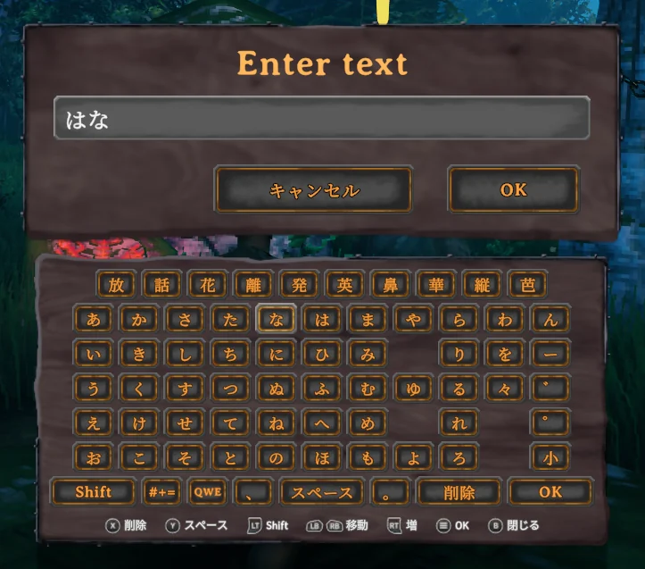

Chinese, pinyin with candidates on the top row:

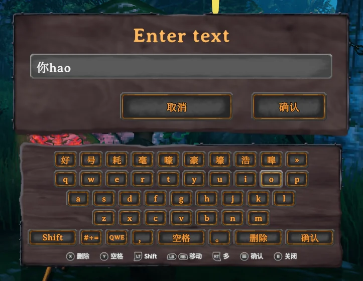

Korean, letters combine into syllables:

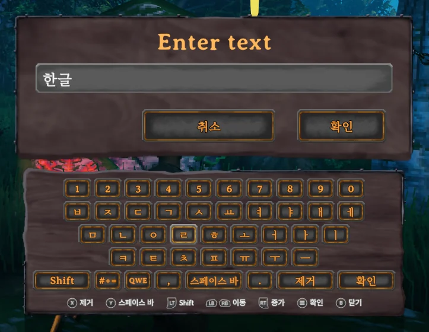

Russian:

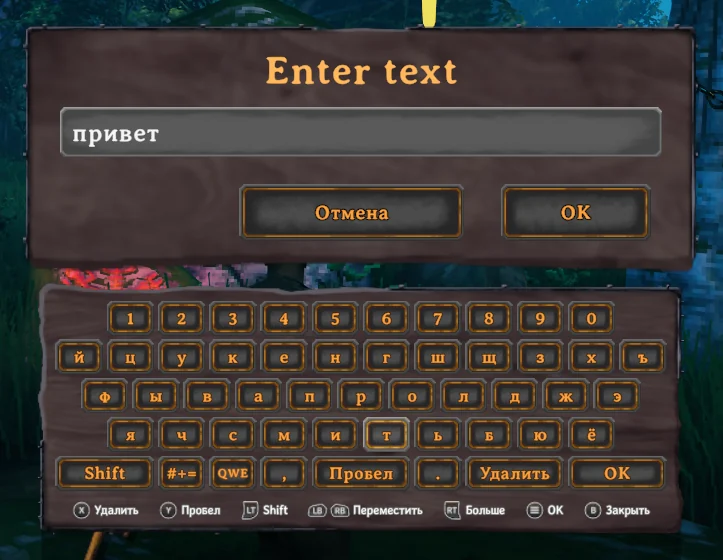

Thai:

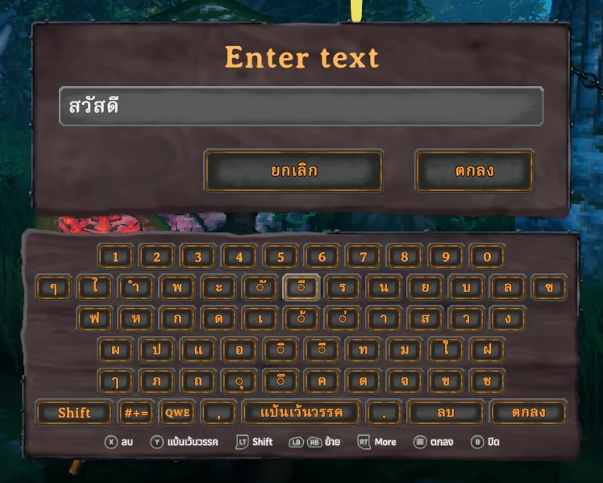
